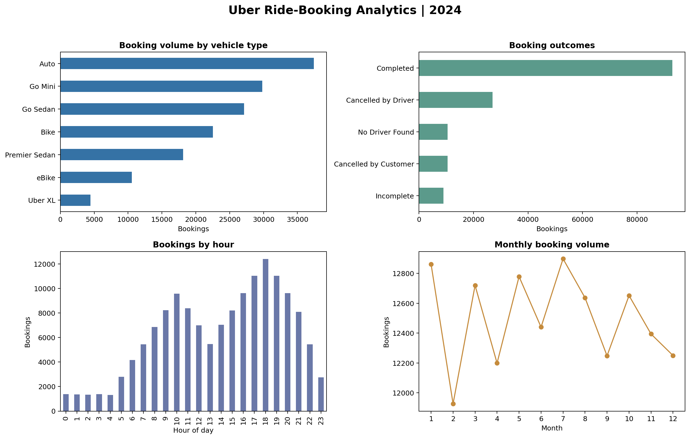

# Uber Ride-Booking Analytics | Python

[](https://www.python.org/)
[](https://pandas.pydata.org/)
[](https://www.statsmodels.org/)
[](https://matplotlib.org/)

An individual Python analytics project exploring 2024 Uber ride-booking activity. The notebook combines data inspection, data cleaning, descriptive statistics, grouped analysis, visual exploration and an OLS regression model for completed rides.

> **Project context:** The broader university assignment was completed collaboratively. The Python notebook published in this repository was **independently developed by me**.
## Project overview

The analysis focuses on five questions:

- How are bookings distributed across vehicle categories and booking outcomes?
- Which vehicle types account for the largest booking volume and recorded booking value?
- How does booking activity vary by hour and month?
- What do the available values indicate about distance, fare and customer/driver ratings?
- How are selected ride characteristics associated with booking value among completed rides?

## Dataset

The project uses a 2024 Uber ride-booking dataset sourced from Kaggle and supplied as `uber_data.csv`.

| Dataset attribute | Description |
|---|---:|
| Booking records | 150,000 |
| Variables | 21 |
| Period | 2024 |
| Completed bookings | 93,000 |
| Vehicle categories | 7 |
| Booking outcomes | 5 |

The data include booking status, vehicle type, pickup and drop-off locations, booking value, ride distance, average arrival/trip times, ratings and payment method.

**Data provenance:** The accompanying university project document identifies Kaggle as the source. The exact Kaggle listing URL and license were not included in the supplied materials. Check the original listing's terms before redistributing or reusing the dataset.

## Selected findings

- **Auto** is the most frequently booked vehicle type, with **37,419 bookings**, followed by Go Mini (**29,806**) and Go Sedan (**27,141**).
- **93,000 bookings** are recorded as completed. Other outcomes are kept distinct: driver cancellation (27,000), customer cancellation (10,500), no driver found (10,500) and incomplete rides (9,000).
- The mean recorded booking value is **508.30** across the **102,000 observations** where this variable is available. It is not an average across all 150,000 bookings.
- The mean ride distance is **24.64 km**, based on 102,000 non-missing observations.
- The OLS model uses **93,000 completed rides** and has an **R² of approximately 0.048**. The selected predictors explain only a limited share of the variation in log booking value; the model is treated as exploratory rather than a high-accuracy prediction tool.



## Analytical workflow

1. **Import and inspect** — load the CSV with Pandas and review dimensions, columns, data types and descriptive statistics.
2. **Python data structures** — use sets and tuples to inspect categories and location overlap.
3. **Booking classification** — distinguish completed, customer-cancelled, driver-cancelled, no-driver-found and incomplete bookings.
4. **Data transformation** — derive price per kilometre and total time in minutes.
5. **Missing-data assessment** — examine missing values overall and by booking status.
6. **Descriptive and grouped analysis** — compare volume, recorded booking value, completion rates, payment methods, hourly demand and pickup locations.
7. **Visualization** — create charts with Matplotlib.
8. **Econometric modelling** — estimate a multiple linear regression (OLS) model using Statsmodels.

### OLS specification

The dependent variable is the natural logarithm of booking value:

`log_Booking_Value`

Explanatory variables:

- Ride distance
- Average driver arrival time (`Avg VTAT`)
- Average trip time (`Avg CTAT`)
- Driver rating
- Customer rating
- Weekend indicator
- Peak-hour indicator

The model is estimated on completed rides with non-missing values for all model variables. The results describe **conditional associations**, not causal effects.

## Important analytical decisions

- `No Driver Found` is classified separately from `Cancelled by Driver`; these are different booking outcomes.
- Missing values are reviewed by booking status before deciding how to handle them. Several missing fields are structural (for example, fares and ratings are unavailable when a ride was not completed), so a single global median/mode imputation would risk introducing artificial values.
- The OLS model uses completed rides and listwise deletion for the variables in the specification.
- Booking-value units and geographic context should be verified against the original Kaggle listing before making external market comparisons.

## Repository structure

```text
uber-ride-booking-analytics/
├── data/
│   └── uber_data.csv
├── images/
│   └── analysis_overview.png
├── notebooks/
│   └── uber_data_analysis.ipynb
├── .gitignore
├── README.md
└── requirements.txt
```

## Run the project

### 1. Clone the repository

```bash
git clone https://github.com/alexmaroiu24/uber-ride-booking-analytics.git
cd uber-ride-booking-analytics
```

### 2. Install dependencies

```bash
python -m pip install -r requirements.txt
```

### 3. Launch Jupyter

```bash
jupyter notebook
```

Open `notebooks/uber_data_analysis.ipynb` and run the cells from top to bottom. The notebook automatically resolves the CSV from the repository's `data/` directory when launched from either the project root or the `notebooks/` directory.

## Technologies

**Python · Pandas · NumPy · Matplotlib · Statsmodels · Jupyter Notebook · Exploratory Data Analysis · Data Cleaning · Descriptive Statistics · OLS Regression**

## Author and contribution

**Alexandru Măroiu**  
Bucharest University of Economic Studies (ASE) · 2026

The Python analysis, preprocessing workflow, descriptive and grouped analysis, data visualizations and OLS estimation in this repository were independently implemented by the author as the Python component of a broader collaborative university assignment.
